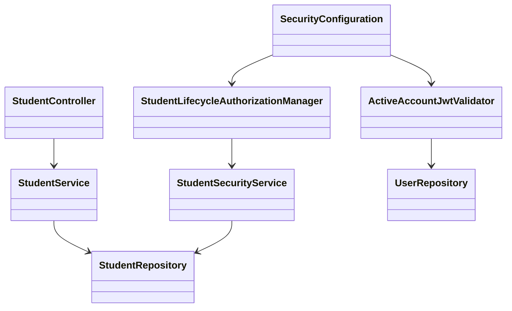
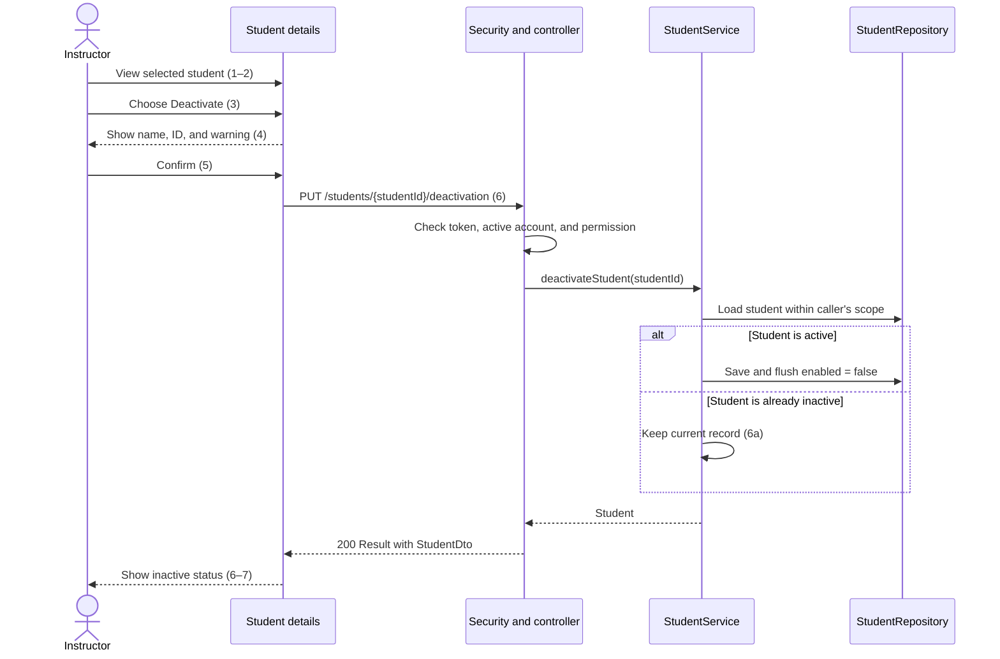

# Student Design

> Realizes: [UC-STU-deactivate-student](../requirements/use-cases.md#uc-stu-deactivate-student-the-course-admininstructor-deactivates-a-student)
> Depends on: FR-SEC-authentication, FR-SEC-authorization, FR-SEC-active-account in the [SRS](../requirements/software-requirements-specification.md).
> Follows the [architectural conventions](architectural-design.md#architectural-conventions), [container view](architectural-design.md#containers), and existing controller → service → repository pattern.

## Overview

Add a confirmed deactivation action to the existing student details form. Keep the current student record and its `enabled` field. The related evaluation changes stay in `EvaluationService`; reminders continue using `SubmissionStatusService` and BR-submission-owed.

## Components and classes

| Component | Work |
|---|---|
| [StudentController](../../backend/src/main/java/team/projectpulse/student/StudentController.java), [StudentService](../../backend/src/main/java/team/projectpulse/student/StudentService.java), [StudentRepository](../../backend/src/main/java/team/projectpulse/student/StudentRepository.java) | Reuse. Add the endpoint, a transactional service method, and a query limited to students the caller may manage. The details lookup must also admit the course owner without a separate course section assignment. |
| [StudentSecurityService](../../backend/src/main/java/team/projectpulse/student/StudentSecurityService.java) | Reuse. Check instructor role and either assignment to the student's course section or ownership of its course. The service repeats the same scope check before saving. |
| `security/authorizationmanagers/StudentLifecycleAuthorizationManager.java` | New. Read `studentId` with `PathVariables` and delegate the permission check to `StudentSecurityService`. |
| `security/ActiveAccountJwtValidator.java`, [SecurityConfiguration](../../backend/src/main/java/team/projectpulse/security/SecurityConfiguration.java), [UserRepository](../../backend/src/main/java/team/projectpulse/user/UserRepository.java) | One new validator. Add it to the existing JWT decoder alongside its normal expiry checks. Look up the token's `userId`; a missing or inactive account fails validation. Keep the signature check. |
| [EvaluationService](../../backend/src/main/java/team/projectpulse/evaluation/EvaluationService.java) | Reuse. Check the evaluatee's active status before adding an evaluation. In the course section report, include an inactive student only when evaluations of her exist for the requested week. Check for saved rows, not a nonzero average. |
| [EditStudentForm.vue](../../frontend/src/pages/students/EditStudentForm.vue), [Students.vue](../../frontend/src/pages/students/Students.vue), [student API](../../frontend/src/apis/student/index.ts) | Reuse. Add a Deactivate button, an Element Plus confirmation dialog, and one API function. Refresh the student list after success. |
| [SubmitTeamsEvaluations.vue](../../frontend/src/pages/evaluations/SubmitTeamsEvaluations.vue) | Reuse. Filter inactive students out of the list used to create new evaluations. Keep the existing saved-evaluation editing path. |

The new validator applies to student and instructor accounts because FR-SEC-active-account covers both. The new authorization manager must deny student self-deactivation. An admin role alone does not grant access to another course's students.

For the details GET only, combine the existing user-ownership manager with the lifecycle manager, so the course owner can reach the warning. Scope its service lookup to the caller herself, an assigned instructor, or the course owner. Keep this read permission separate from the existing profile-edit and delete rules. The lifecycle service's scoped lookup returns a neutral `403` on no match, including when the student disappears or permission changes after the route check; treat this as a permission denial, not an `ObjectNotFoundException` (`404`).

## Deactivation sequence

The dialog explains account access, reminders, new evaluations, retained membership and work, and possible reactivation, as specified in the use case. Cancel, Escape, and closing the dialog send no request. Disable Confirm while saving. Show success only for a successful `Result` containing `enabled: false`. A failed request shows failure; an unanswered or unusable result asks the instructor to reload before trying again, with no success or automatic retry. Use the shared Axios instance and its existing login/forbidden handling.

For an active student, replace the editable status switch with status text and the Deactivate button. Keep the existing status switch for an inactive student so her current reactivation path still works.

## API contract

All responses use the existing `Result` envelope. Caller identity comes from `UserUtils`, never the request body.

| Endpoint | Caller and input | Success | Errors |
|---|---|---|---|
| Existing `GET /api/v1/students/{studentId}` | Existing readers, plus the course owner even without a course section assignment. Path ID only. | Existing StudentDto, used to identify the student in the warning. | Existing `401`; neutral `403` for an unknown or out-of-scope target, at either enforcement point. |
| New `PUT /api/v1/students/{studentId}/deactivation` | Course owner or instructor assigned to the student's course section. Path ID only; no body. Register the lifecycle manager before the API's deny-all rule. | `200`, StudentDto with `enabled: false`. An already inactive student returns the same state. | `401` for extension 1a. `403` for 2a or 6b, including an unknown target. `500` for 6c after rollback. No response is handled by the page under 6d. |
| Existing `PUT /api/v1/students/{studentId}` | Existing profile-edit permissions and body. | Existing response for profile changes. Keep the existing reactivation behavior. | `400` if any caller tries to change an active student to inactive through profile editing; direct her to the dedicated action. Reject the profile save before changing fields. |
| Existing `POST /api/v1/evaluations` | Existing student permissions and body; creates a new evaluation. | Existing response for an active teammate. | `400` for a new evaluation of an inactive teammate, including a stale page; ask the student to reload the targets (UC-EVA-submit-evaluation 9a). |
| Existing `PUT /api/v1/evaluations/{evaluationId}` | Existing evaluator permissions and body. | Existing update response, including a saved evaluation of a now-inactive teammate while its submission window is open. | Existing access, validation, and closed-window errors; do not apply the new-target active check to saved evaluations. |
| Existing `GET /api/v1/evaluations/sections/{sectionId}/week/{week}` | Existing course section report permissions and inputs. | Existing report, with inactive students included under BR-deactivated-student-report. | Existing access and input errors. |

## Key decisions

| Choice | Reason and alternative |
|---|---|
| Keep the team assignment | This preserves the link used by existing reports. Removing the student would need extra handling for that history. BR-submission-owed already excludes inactive members. |
| Choose historical report rows by saved evaluations | Filtering out every inactive student would hide past results. A withdrawal-date cutoff would need new data and could still hide valid records. |
| Check account status when validating each token | Waiting for the two-hour token expiry would break FR-SEC-active-account. Reuse the current user repository instead of adding a token blocklist. |
| Use a separate lifecycle permission check | The existing user-ownership manager also admits the student herself. That is too broad for this action. |
| Accept repeated deactivation | The first request may have succeeded even if its response was lost. Returning a conflict would make that retry harder to handle. |
| Check new evaluation targets on the server | Hiding a teammate in the page alone does not stop a stale page or a direct API request. Saved evaluations keep their existing edit window. |

## Data and shared code

There is no schema change. Reuse the [student model](../../backend/src/main/java/team/projectpulse/student/Student.java) and the SRS's [Business Domain Model](../requirements/software-requirements-specification.md#business-domain-model). Deactivation changes only `enabled`; it does not call a delete method or change enrollment, team membership, activities, evaluations, or ratings.

Commit the shared JWT and evaluation changes separately, with their tests, before adding the endpoint and UI. Keep each `SecurityConfiguration` change in its own commit, including the JWT wiring and the new route's permission rule. Pause to review the shared changes before building the rest. These changes stay within the existing component boundaries.

## Test list

Each row states an expected result from the use case or a cited rule. Unit tests use the project's JUnit 5 and Mockito pattern. API tests use the existing MySQL test containers. UI tests use the existing Cypress setup.

| ID | Flow or rule | Level | Expected result |
|---|---|---|---|
| T01 | Main scenario; BR-student-deactivation-membership | Integration | An assigned instructor deactivates the student. A fresh database read shows `enabled: false`; enrollment, team, activities, evaluations, and ratings are preserved. Include a student without a team. |
| T02 | BR-student-lifecycle; steps 2–6 | Integration | The course owner can load the student's details and deactivate her even without a separate course section assignment. Self and assigned-instructor details access still works; another course's owner cannot read the target. |
| T03 | Extension 1a | Integration | Missing credentials and an inactive caller are refused with `401`; the target is unchanged. |
| T04 | Extension 2a | Integration | Student self, another student, an unassigned instructor, an admin of another course, and unknown or malformed target IDs receive `403`; nothing changes. Unknown and out-of-scope targets give the same neutral error with no student fields. |
| T05 | Extension 4a | UI integration | Cancel, Escape, and close dismiss the warning and send no deactivation request. |
| T06 | Extension 6a | Unit and integration | Repeating an authorized request succeeds without another save or changes to retained data. |
| T07 | Extension 6b; scoped lookup | Unit and integration | An instructor removed from the course section after loading the warning cannot confirm deactivation. An empty scoped lookup after route approval also returns the neutral `403`, with no changes. |
| T08 | Extension 6c | API and UI integration | Force a persistence failure. The API returns failure; a fresh read shows rollback. The page shows failure and never success. |
| T09 | Extension 6d | UI integration | A network failure or unusable response shows an unknown result and asks for a reload, with no success or automatic retry. After a committed but lost response, reloading shows inactive; an explicit authorized retry follows 6a. |
| T10 | FR-SEC-active-account | Integration | A student's token works before deactivation and receives `401` afterward. Fresh login also fails. Another active student still has access. |
| T11 | JWT validation; FR-SEC-authentication | Unit and integration | Missing or invalid `userId`, a deleted account, and inactive student or instructor accounts fail validation. Fresh login also rejects both inactive account types. Expired tokens and tokens with an invalid signature still receive `401` through the configured security filter chain. |
| T12 | BR-submission-owed | Unit | The inactive student owes neither item. Active teammates no longer owe an evaluation of her. |
| T13 | BR-evaluation-active-evaluatee | Unit and integration | A new evaluation of an inactive teammate is rejected, including a stale-page request. An active teammate remains a valid target. An authorized evaluator can still update a saved evaluation of an inactive teammate within its window; a closed window still rejects edits. |
| T14 | BR-deactivated-student-report | Unit | An inactive student with saved evaluations appears for that week, including zero scores and a retained result after a separate team removal. Retained scores, ratings, comments, and visibility rules are unchanged. Omit inactive students with no results for that week and active students without a team. |
| T15 | Separate confirmed action | Unit and integration | For each role allowed to edit profiles, an active-to-inactive profile save returns `400` with no field changes. Ordinary profile edits and the existing inactive-to-active update still work. |
| T16 | Steps 4–6; BR-evaluation-active-evaluatee | UI integration | Show the target and every warning effect in the UC's Associated Information, send one confirmed request, prevent duplicate clicks, and refresh status after success. New evaluation targets omit inactive teammates; saved evaluations keep their editing path. A stale-target rejection asks for a reload. |

## Limits to check during implementation

- Account validation adds a user lookup per authenticated request. A failed lookup must deny access.
- Reuse the existing [MyUserPrincipal.isEnabled()](../../backend/src/main/java/team/projectpulse/user/MyUserPrincipal.java) login check; T10–T11 verify it alongside the new JWT check. Account deactivation now blocks the next protected request; individual-token revocation remains outside this design.
- Requests accepted before deactivation finishes may complete, as stated in the use case.
- The design does not build UC-STU-reactivate-student. Its Associated Information records the membership decision for later work.
- The build PR must report which tests actually ran. Test code alone is not verification.
